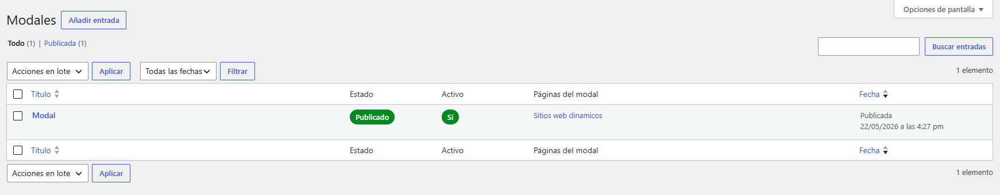
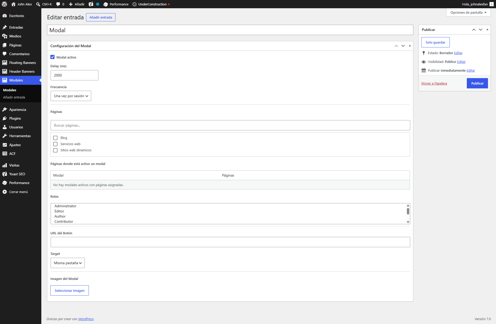
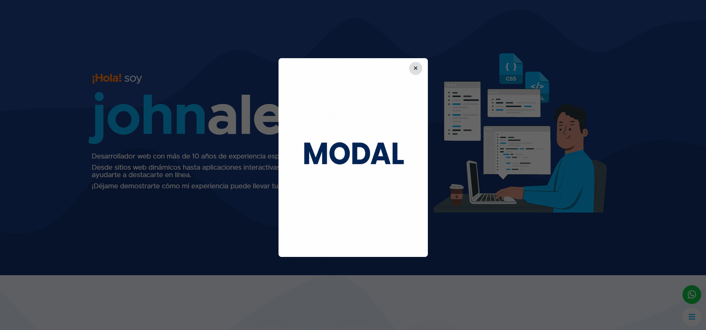

# SPEC Modal Pro

Plugin WordPress para gestionar modales promocionales segmentados por página.

## Descripción

SPEC Modal Pro crea un Custom Post Type privado (`smp_modal`) para administrar modales con imagen clickeable o video (MP4/WebM o YouTube) con botón de acción, frecuencia y páginas asignadas. El plugin no crea URLs públicas propias y no modifica metadata SEO, canonicales, schema ni configuración de Yoast SEO.

## Funcionalidades

- CPT privado para modales.
- Estado activo/inactivo por modal.
- Segmentación por páginas con ruta jerárquica padre/hija en el selector.
- Delay configurable.
- Frecuencia `session` o `persistent` de 1 hora.
- Programación opcional con fecha de inicio y fecha de fin.
- Estado administrativo calculado por programación: sin fechas usa `Publicado` / `Borrador`; con fechas usa `Programado`, `Publicado` o `Borrador`.
- Cambio automático a borrador cuando la fecha de fin ya está vencida.
- Tipo de contenido por modal: imagen, video MP4/WebM de la biblioteca de medios o video de YouTube.
- URL y target para enlazar la imagen del modal.
- ID opcional para seguimiento en Tag Manager sobre el enlace de la imagen.
- Con video MP4/WebM o YouTube se muestra un botón adicional debajo del video con la URL, el target, el ID Tag Manager y un texto configurable (por defecto `Más información`).
- Portada obligatoria para video MP4/WebM (`_smp_video_poster_id`): imagen de la biblioteca de medios que se muestra como `poster` mientras el video carga, en lugar de una pantalla negra.
- Campos obligatorios para publicar: video MP4/WebM exige video, portada, título móvil y descripción corta; YouTube exige título móvil y descripción corta. El botón Publicar/Actualizar avisa en el editor y, si faltan, el servidor guarda el modal como borrador con un aviso. Guardar borrador sigue permitido. Los modales de video ya publicados sin portada se siguen mostrando hasta que se vuelvan a guardar.
- Versión móvil para video MP4/WebM y YouTube (`_smp_mobile_title`, máx. 80 caracteres; `_smp_mobile_description`, máx. 160): por debajo de 800px se oculta el video y se muestran el título, la descripción corta y el mismo CTA. El video no se descarga en móvil. Los modales de imagen, y los de video sin versión móvil, siguen ocultos por debajo de 800px.
- Carga de video priorizando la imagen: el MP4/WebM usa `preload="none"` y su portada va en `data-smp-poster`, así que no se descarga al cargar la página ni en móvil. En escritorio la portada se precarga con prioridad baja después del evento `load`; al abrir el modal se muestra la portada y solo cuando termina de cargar se pide la metadata del video.
- YouTube con miniatura previa: al abrir el modal se muestra la miniatura del video (`i.ytimg.com`, `hqdefault.jpg`) con un botón de reproducir. El reproductor de `youtube-nocookie.com` (con `autoplay=1`) solo se carga al pulsarlo, así que basta un clic, igual que antes. Al cerrar el modal se detiene el video y vuelve la miniatura.
- El modal de video se adapta a la proporción real del archivo MP4/WebM (vertical, horizontal o cuadrado) sin franjas negras y limitado al alto de la pantalla. La proporción se envía desde PHP con el ancho y alto que WordPress guarda en la metadata del video (o, si faltan, con las dimensiones de la portada), así el modal aparece desde el inicio con su forma final y no salta de 16:9 a vertical; el JS la confirma al leer la metadata del archivo. YouTube usa 16:9 y los enlaces `shorts/` se muestran en 9:16.
- Imagen obligatoria para publicar.
- Solo visible en desktop: por debajo de 800px de viewport el modal no se abre (guard en `frontend.js` con `matchMedia`), no carga su video ni consume la frecuencia; `frontend.css` también lo oculta como respaldo.
- Columnas administrativas de estado, activo y páginas asignadas.
- Tabla informativa de páginas donde hay modales activos.
- Assets separados para admin y frontend.
- Internacionalización mediante text domain `spec-modal-pro`, traducción inglesa `en_US` y fallback interno para locales `en*`.

## Capturas

Sube las imágenes de referencia en `docs/images/` usando estos nombres para que se muestren aquí automáticamente.

### Listado en administrador



### Configuración del modal



### Vista en frontend



## Seguridad

- Bloqueo de acceso directo con `ABSPATH`.
- Nonce en guardado de metabox.
- Validación de permisos con `current_user_can()`.
- Sanitización con `absint()`, `sanitize_key()`, `sanitize_html_class()`, `sanitize_text_field()` y `esc_url_raw()`.
- Allowlists para frecuencia, target, tipo de contenido (`image`, `video`, `youtube`) y MIME de video (`video/mp4`, `video/webm`).
- Validación de URL de YouTube por host (`youtube.com`, `youtu.be`, `youtube-nocookie.com`) e ID de 11 caracteres.
- Validación de páginas tipo `page`.
- Escape de salida con `esc_html()`, `esc_attr()`, `esc_url()` y `wp_kses_post()`.
- `rel="noopener noreferrer"` cuando el enlace abre en nueva pestaña.

## Código limpio y mantenibilidad

Este plugin debe mantenerse legible, modular y escalable:

- Funciones `smp_` pequeñas y enfocadas en una sola responsabilidad.
- Nombres descriptivos para estado, delay, frecuencia, páginas, roles, CTA, imagen y target.
- Lógica de segmentación, frecuencia y cierre expresada de forma clara y verificable.
- Validaciones explícitas para roles, páginas, frecuencia, target, URLs e IDs.
- JS encapsulado, sin variables globales innecesarias, listeners duplicados ni `console.log`.
- CSS del modal acotado al namespace del plugin para reducir conflictos visuales.
- Comentarios solo cuando expliquen decisiones de accesibilidad, compatibilidad o persistencia.

## SEO / GEO / AEO

- No genera CPT público ni URLs indexables propias.
- No duplica metadata, canonicales ni schema de Yoast.
- Usa HTML accesible para el modal con `role="dialog"` y `aria-modal="true"`.
- Las imágenes se renderizan mediante `wp_get_attachment_image()`.
- Los videos no afectan el LCP inicial: se cargan solo cuando el modal se muestra, y el iframe de YouTube tiene `title` accesible.

## Estructura

```text
spec-modal-checklist/
  spec-modal-checklist.php
  README.md
  assets/
    css/
      admin.css
      frontend.css
    js/
      admin.js
      frontend.js
  languages/
    spec-modal-pro.pot
    spec-modal-pro-en_US.po
    spec-modal-pro-en_US.mo
    spec-modal-pro-en_US.l10n.php
  docs/
    images/
      admin-list.png
      admin-config.png
      frontend.png
```

## Validación recomendada

```bash
php -l spec-modal-checklist.php
node --check assets/js/admin.js
node --check assets/js/frontend.js
```

Validar traducciones:

- Cambiar el idioma de WordPress o del usuario administrador a English (United States).
- Confirmar que el CPT, metabox, columnas administrativas, frecuencia, selector de medios y botón de cierre muestran textos en inglés.
- Volver a Español y confirmar que los textos originales se mantienen.

Nota: el plugin incluye fallback interno para locales `en*`, por lo que los textos visibles del administrador y el botón de cierre del modal deben mostrarse en inglés incluso si WordPress no carga el archivo `.mo` o `.l10n.php`.

Validar en WordPress:

- Crear y editar modal.
- Seleccionar imagen.
- Guardar URL y target.
- Guardar ID Tag Manager y confirmar que se renderiza como `id` del enlace cuando existe URL.
- Cambiar el tipo de contenido a video MP4/WebM, seleccionar un video y confirmar el botón debajo del video con URL, target, texto e ID Tag Manager.
- Cambiar el tipo de contenido a YouTube con enlaces `watch?v=`, `youtu.be` y `shorts/`, y confirmar que el video carga solo al abrirse el modal.
- Cerrar el modal con video en reproducción y confirmar que el audio se detiene.
- Confirmar que los modales existentes (sin tipo guardado) siguen mostrándose como imagen.
- Asignar páginas.
- Confirmar que el selector muestra jerarquía de páginas cuando existen padres.
- Revisar columnas administrativas.
- Configurar fecha de inicio futura y fecha de fin vencida para confirmar que la vigencia controla el render.
- Confirmar que un modal publicado con fecha de fin vencida pasa automáticamente a borrador en el administrador.
- Verificar render frontend, cierre y frecuencia.

## Rollback

Restaurar `spec-modal-checklist.php`, los archivos en `assets/` y la carpeta `languages/`. No hay migraciones de base de datos; el plugin usa post meta estándar:

- `_smp_enabled`
- `_smp_delay`
- `_smp_frequency`
- `_smp_start_date`
- `_smp_end_date`
- `_smp_pages`
- `_smp_cta_url`
- `_smp_cta_id`
- `_smp_cta_target`
- `_smp_cta_label`
- `_smp_image_id`
- `_smp_media_type`
- `_smp_video_id`
- `_smp_youtube_url`
